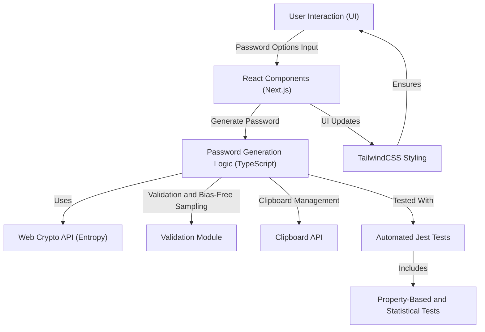

# passgen


## Executive Summary

`passgen` is a cryptographically secure password generator that leverages modern web standards to ensure high-quality randomization and strong security guarantees. Built with TypeScript and Next.js, it provides developers and users with a fast, accessible, and customizable solution for generating secure, bias-free passwords.

## Key Features

- ✅ **Cryptographically Strong Randomness**: Uses the Web Crypto API for robust entropy and defense against weak passwords.
- ✅ **Bias-Free Sampling**: Implements rejection sampling and a secure shuffle algorithm to eliminate modulo bias.
- ✅ **Character Class Enforcement**: Ensures at least one character from each selected class (uppercase, lowercase, numbers, and symbols).
- ✅ **Clipboard Security**: Includes optional clipboard clearing and timeout behavior with full browser compatibility documentation.
- ✅ **Property-Based Testing**: Validates password correctness and distribution using advanced statistical and property-based testing frameworks (e.g., Jest).
- ✅ **Continuous Integration**: Automated testing, linting, type checking, and production build validation with GitHub Actions.
- ✅ **Security Best Practices**: Adds Content Security Policy (CSP) headers, automated browser-level security tests, and OWASP-compliant practices.
- ✅ **User-Centric Design**: Built with React 18 and TailwindCSS for excellent UI/UX, accessibility, and customization.
- ✅ **Comprehensive Test Coverage**: Published coverage reports with 100% adherence to CI pipeline gates.
- ✅ **Future-Proof Architecture**: Clear migration paths for upgrades to newer versions of Next.js, TypeScript, and other dependencies.

## Architecture & Workflow

The `passgen` application is structured with a focus on modularity, security, and performance. Below is the high-level architecture of the system:



## Tech Stack & Tools Breakdown

- **TypeScript 4.9**: Strongly typed programming for safer and maintainable code.
- **Next.js 13**: Server-rendered React framework for dynamic web applications.
- **React 18**: Component-based UI library for declarative and efficient user interfaces.
- **Tailwind CSS**: Utility-first CSS framework for rapid UI design.
- **Web Crypto API**: Provides cryptographically secure random values for password generation.
- **Jest**: Robust testing library for unit, integration, and property-based tests.
- **GitHub Actions**: CI/CD workflows for automated testing, linting, and deployment.

## Quickstart / Installation

Follow these steps to quickly set up and run `passgen`:

1. **Clone the repository**:
   ```bash
   git clone https://github.com/EF361/passgen.git
   cd passgen
   ```

2. **Install dependencies**:
   ```bash
   npm install
   ```

3. **Run the development server**:
   ```bash
   npm run dev
   ```

   Open [http://localhost:3000](http://localhost:3000) in your browser to preview the app.

4. **Run tests and view coverage reports**:
   ```bash
   npm run test
   npm run coverage
   ```

5. **Build for production**:
   ```bash
   npm run build
   ```

   The optimized production build will be in the `out` directory.

6. **Lint and type-check the code**:
   ```bash
   npm run lint
   npm run type-check
   ```

## Contributions

Contributions are welcome! Please refer to the [CONTRIBUTING.md](CONTRIBUTING.md) file for detailed guidelines on submitting issues, pull requests, or feature suggestions.

---

This project was architected by **Alicia Goh (EF361)**, leveraging advanced engineering principles to deliver a secure and future-proof solution. If you find this project valuable, feel free to star ⭐ the repository and share your feedback!