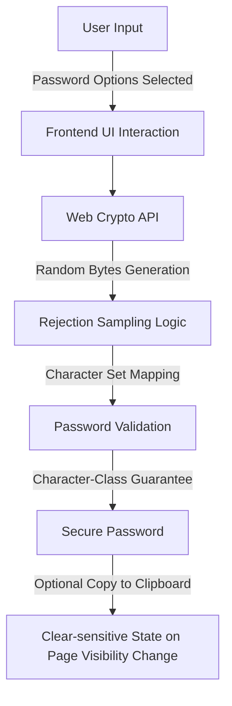

# passgen


## Executive Summary

`passgen` is a secure and customizable password generator built with a modern TypeScript/React stack and compliant with cryptographic best practices. It empowers users to generate strong, unbiased passwords with guaranteed character-class rules, while prioritizing data security across both implementation and UI interactions.

## Key Features

- **Cryptographically Secure Password Generation**: Uses the Web Crypto API with rejection sampling to ensure unbiased randomization.
- **Guaranteed Character-Class Inclusion**: Ensures every enabled character type (e.g., uppercase, numbers, symbols) is represented.
- **Comprehensive Input Validation**: Handles edge cases such as empty character sets, extreme password lengths, and invalid configurations.
- **Resilient Error Handling**: Explicit handling of browser API failures and invalid user inputs.
- **Privacy-Focused**: Avoids logging, transmitting, or persisting passwords. No analytics or URLs contain sensitive data.
- **Dynamic Clipboard Integration**: Copy passwords securely with explicit handling of sensitive UI states when the page is minimized or hidden.
- **Responsive Design**: Modern UI built with Tailwind CSS for a seamless experience on any device.
- **Extensive Test Coverage**: Includes unit and property-based tests for length constraints, character coverage, and bias-sensitive logic.
- **Version Pinning**: Ensures stable builds by locking dependencies, including Node.js.
  
## Architecture & Workflow



This architecture prioritizes cryptographic reliability at each stage while preventing accidental leaks of sensitive data in the UI.

## Tech Stack & Tools Breakdown

- **Front-end Framework**: Next.js (for SSR and optimized builds)
- **UI Library**: React (dynamic and reusable components)
- **Styling**: Tailwind CSS (lightweight, utility-first CSS)
- **Programming Language**: TypeScript (strongly typed, safer development)
- **Cryptography**: Web Crypto API (browser-native, cryptographically secure random numbers)
- **Testing Tools**: Jest (unit and property-based tests for robust validation)

## Quickstart / Installation

### Prerequisites
- **Node.js**: Ensure you have Node.js v18.x installed (pinned for dependency stability).
- **npm**: npm v8.x+ is required for package installation.

### Clone the Repository
```bash
git clone https://github.com/EF361/passgen.git
cd passgen
```

### Install Dependencies
```bash
npm install
```

### Run the Development Server
```bash
npm run dev
```

### Build for Production
```bash
npm run build
```

### Run Tests
```bash
npm run test
```

## Security Considerations
- Generated passwords are **NOT** logged, saved, or transmitted.
- Clipboard actions are explicitly triggered by the user, and sensitive UI state is cleared when the page loses visibility.
- Extreme input scenarios are gracefully handled to prevent crashes or invalid outputs.

## License

This project is licensed under the [MIT License](./LICENSE).