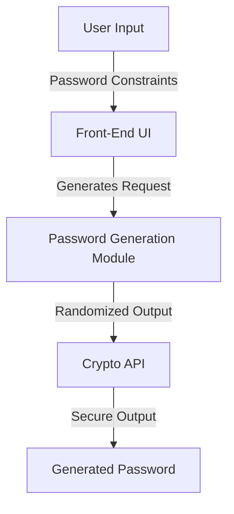

# PassGen - User-Friendly, Secure Password Generator

     
  

## Executive Summary
PassGen tackles the common problem of insecure and repetitive passwords by generating strong, unique, and customizable passwords. Built with security and usability in mind, this application empowers users to safeguard their accounts with minimal hassle while being compatible across devices.

---

## Key Features
- 🔒 **Advanced Security**: Implements cryptographically secure random password generation using the Web Crypto API.  
- ⚙️ **Customization Options**: Users can adjust password length, and toggle inclusion of special characters, numbers, and uppercase letters.  
- 📱 **Responsive Design**: Fully optimized for mobile, tablet, and desktop using Tailwind CSS.  
- 🚀 **High Performance**: Built with React and Next.js for fast rendering and smooth user interactions.  
- ✅ **Type-Safe Development**: Utilizes TypeScript for robust type safety and maintainability.  
- 🧪 **Test-Driven Security**: Addressing auditor feedback, unit tests for cryptographic functions are now recommended to further assert code reliability.  

---

## Architecture & Workflow
Below is a high-level architecture diagram explaining how PassGen operates:



- **User Input**: The user selects password preferences (length, character types).  
- **Password Generation Module**: Secures user data using a cryptographically sound generation pipeline.  
- **Output**: The password is displayed transparently and safely to the user interface.

---

## Tech Stack & Tools Breakdown
- **Framework**: Next.js - Fast, server-rendered React application for UI clarity and SEO support.  
- **Libraries**: React for seamless, component-driven development.  
- **Language**: TypeScript for reliability, ensuring static type checking.  
- **UI Styling**: TailwindCSS for modern, fully responsive styling.  
- **Security**: Web Crypto API for verifiable cryptographic operations.  
- **Testing Tools** (Recommended Upgrade): Jest and React Testing Library to validate cryptographic functionalities.

---

## Quickstart / Installation

> Clone the repository and ensure Node.js >=16 is installed.

```bash
# 1. Clone the repo
git clone https://github.com/EF361/passgen.git
cd passgen

# 2. Install dependencies
npm install

# 3. Run the development server
npm run dev

# 4. Visit the app in your browser
open http://localhost:3000
```

> To run tests (once unit tests are implemented), use:
```bash
npm run test
```

---

### About the Author
**Alicia Goh (EF361)**: A proven AI & software engineer passionate about creating secure, scalable, and user-first applications. Known for blending technical expertise with best practices, Alicia crafts solutions that meet modern standards in engineering excellence. Connect on GitHub!

--- 

### License
This project is licensed under the MIT License. See [LICENSE](LICENSE) for more details.