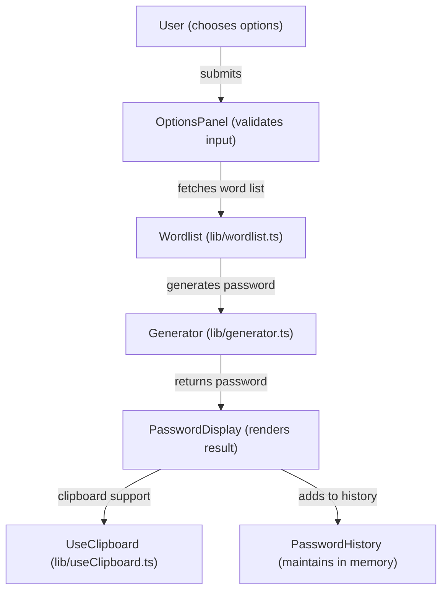

# Entropass: Secure Client-Side Password Generator


[Live demo](https://intelligent-curie-alpha.vercel.app)  
<!-- Screenshot: add docs/screenshot.png -->

## Overview

Entropass is a secure client-side password generation application. Designed with security and usability in mind, it uses strong randomness sources, enforces customizable password requirements, and avoids storing sensitive data. The core logic ensures high entropy while maintaining flexibility for real-world constraints.

## Features

- Secure in-browser randomness using cryptographic entropy sources in `lib/generator.ts`.
- Rejection sampling to meet mandatory character requirements.
- Configurable password generation through `components/OptionsPanel.tsx` (e.g., length, symbols, uppercase).
- In-memory-only password history view in `components/PasswordHistory.tsx`.
- Entropy visualization with a `StrengthMeter` component.
- Support for clipboard functionality via `lib/useClipboard.ts` with auto-clear.
- Modern responsive UI built in `Next.js 15` with Tailwind CSS 3.
- Automated testing and continuous integration with GitHub Actions.

## How It Works



## Tech Stack

- **TypeScript**
- **Next.js 15**
- **React 19**
- **Tailwind CSS 3**
- **QRCode.react** for QR code generation

## Getting Started

### Prerequisites

- Node.js (version 18 or later recommended)

### Installation

1. Clone the repository:
   ```bash
   git clone https://github.com/EF361/entropass.git
   cd entropass
   ```

2. Install dependencies:
   ```bash
   npm install
   ```

### Development

Start the development server:
```bash
npm run dev
```

### Build for Production

Build the application:
```bash
npm run build
```

Serve the built application:
```bash
npm run start
```

## Project Structure

```
.
├── app
│   ├── apple-icon.svg
│   ├── globals.css
│   ├── layout.tsx
│   ├── page.tsx
├── components
│   ├── BatchPanel.tsx
│   ├── OptionsPanel.tsx
│   ├── PasswordDisplay.tsx
│   ├── PasswordHistory.tsx
│   ├── StrengthMeter.tsx
│   ├── ThemeToggle.tsx
├── lib
│   ├── generator.ts
│   ├── useClipboard.ts
│   ├── wordlist.ts
├── public
│   ├── favicon.svg
│   ├── icon.svg
├── test-generator.ts
├── LICENSE
├── README.md
└── package.json
```

## Testing

Automated tests for key functionality are included in the repository. To run the tests, use the following command:

```bash
npm test
```

Tests cover the password generation logic (`test-generator.ts`) with a focus on expected output and edge conditions.

## Roadmap

- [ ] Add statistical and property-based tests for entropy distribution and sampling accuracy.
- [ ] Document entropy calculations and clarify potential constraints on uniformity.
- [ ] Perform a cryptographic review of the generation method and assumptions.
- [ ] Expand and document the passphrase dictionary for enhanced usability.

## License

This project is licensed under the MIT License. See the [LICENSE](./LICENSE) file for more information.

---

Built by [Alicia Goh](https://github.com/EF361)