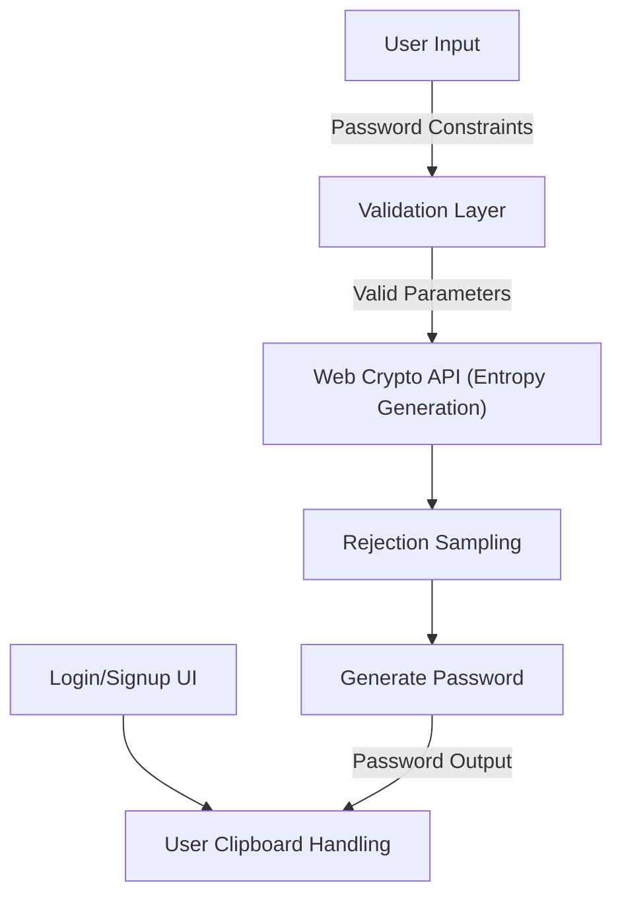

# PassGen: Secure Password Generator


---

### 🚀 Executive Summary
PassGen is a robust, security-focused password generator built for developers and end-users who need strong, randomly generated passwords. It leverages modern cryptographic techniques via the Web Crypto API, ensuring resistance to predictable patterns or common biases.

---

### 🔑 Key Features
- **Cryptographically Secure Generation**: Uses the Web Crypto API to generate entropy for passwords.
- **Bias Avoidance**: Implements rejection sampling to mitigate modulo bias.
- **Customizable Parameters**: Fine-grained controls for character classes, password lengths, and complexity requirements.
- **Fail-Safe Defaults**: Ensures no character class is enabled or password lengths are invalid.
- **Comprehensive Testing**: Property-based tests, unit tests, and type-checking integrated within CI workflows.
- **Responsive UI**: Built with Next.js 13, React 18, and Tailwind CSS to ensure a seamless user experience.
- **Security Auditing**: Threat modeling includes clipboard exposure, DOM persistence, JavaScript-managed state, and external risks.
- **Hardening Practices**: Safe patterns for handling JavaScript state and reduction of client-side vulnerabilities.

---

### 🛠️ Architecture & Workflow
PassGen follows a modern, security-driven architecture that integrates CI pipelines to automate testing, linting, and secure build processes.



**High-Level Workflow**:
1. User selects password criteria (length, character classes, etc.).
2. Validations ensure inputs are secure and constraints are met.
3. Randomness is generated using the Web Crypto API.
4. Passwords are bias-checked and shuffled securely before output.
5. Passwords are displayed in the UI, with options to copy to clipboard safely.

---

### 🧑‍💻 Tech Stack & Tools
- **Core Framework**: [Next.js 13](https://nextjs.org/)
- **UI Library**: [React 18](https://react.dev/) + [Tailwind CSS](https://tailwindcss.com/)
- **Language**: [TypeScript](https://www.typescriptlang.org/)
- **Cryptography**: [Web Crypto API](https://developer.mozilla.org/en-US/docs/Web/API/Web_Crypto_API)
- **Testing**: [Jest](https://jestjs.io/) with support for property-based testing.
- **CI/CD**: GitHub Actions (type-checking, linting, tests, production builds, and lockfile security scanning).

---

### ⚡ Quickstart / Installation
```bash
# Clone the repository
git clone https://github.com/EF361/passgen.git
cd passgen

# Install dependencies
npm install

# Start the development server
npm run dev

# Run type-checking
npm run type-check

# Run linting
npm run lint

# Run tests (unit + property-based)
npm test

# Build for production
npm run build
```

Visit the app running locally at `http://localhost:3000`.

---

### 🔒 Threat Model
1. **Clipboard Exposure**: Passwords copied to the clipboard remain vulnerable during the clipboard lifetime.
2. **Browser Extensions**: Malicious extensions could intercept password data.
3. **DOM Persistence**: The generated password is momentarily persisted in the DOM but never saved to permanent storage.
4. **Screenshots**: Passwords visible in the UI can be captured by screenshots.
5. **State Clearing**: JavaScript session data isn't cleared on application refresh — ensure manual clearing is implemented.

PassGen mitigates risks by limiting password surface lifetime in the DOM and avoids processing password state beyond active sessions.

---

### 🏆 About the Developer
**Alicia Goh (EF361)**, a Senior Software Engineer, is dedicated to delivering secure and user-centric web applications. Her expertise in TypeScript, React, and security-driven architectures brings exceptional value to PassGen, a testament to her focus on developer tools and usability.