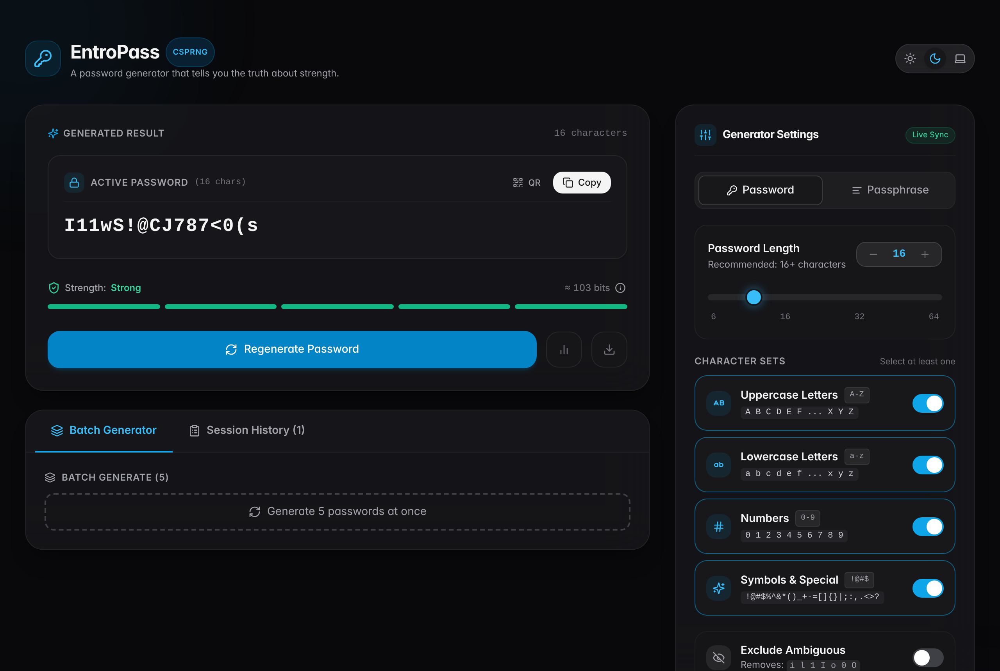
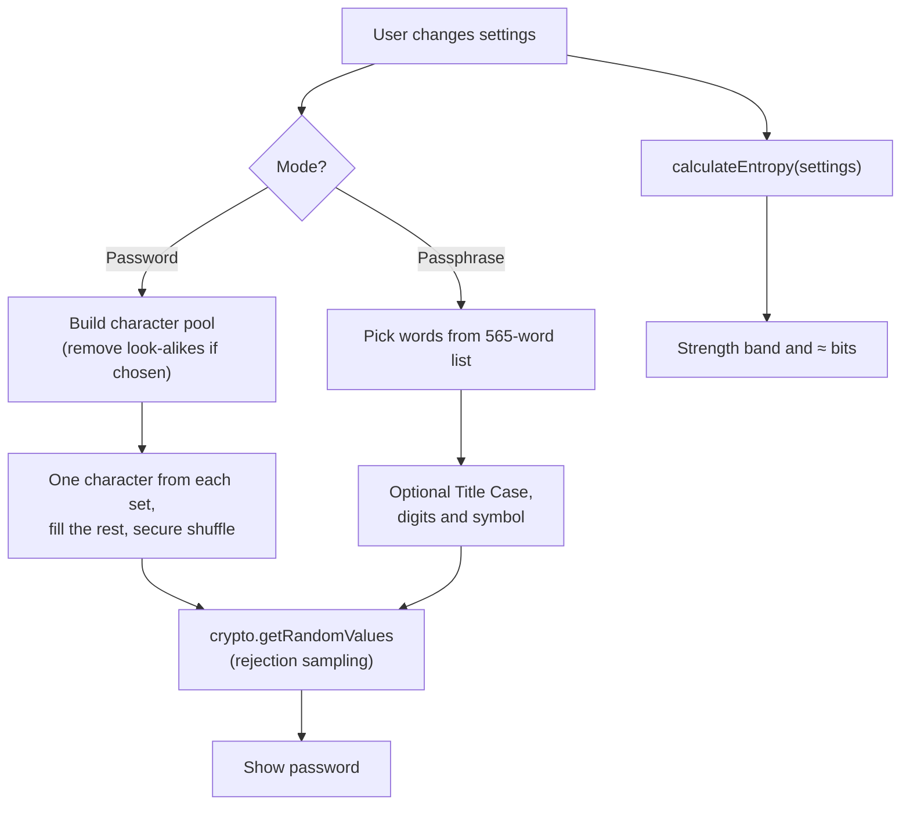

# EntroPass

A password generator that tells you the truth about strength.

[](https://github.com/EF361/passgen/actions/workflows/ci.yml)


**Live demo:** [entropass.vercel.app](https://entropass.vercel.app)



## Features

- **Password mode:** 6–64 characters, uppercase, lowercase, numbers and symbols, with an option to exclude look-alike characters (`i l 1 I o 0 O |`). Every selected set appears at least once.
- **Passphrase mode:** 3–8 words from a 565-word list, with optional Title Case, two injected digits, one injected symbol, and a choice of separator.
- **Honest strength meter:** strength comes from the generation settings, not from how the output looks.
- **Secure randomness:** `crypto.getRandomValues` with rejection sampling (no modulo bias) and a Fisher–Yates shuffle.
- **Clipboard auto-clear:** clears the clipboard 30 seconds after copying, with a countdown. Can be turned off.
- **Extras:** QR code, batch of 5, session history (last 10, kept in memory only), `.txt` export, character breakdown, light/dark/system theme.
- **Security headers:** Content-Security-Policy, `Referrer-Policy: no-referrer`, `X-Content-Type-Options: nosniff` and a locked-down `Permissions-Policy`.
- **Client-side only:** passwords are generated in the browser and never sent to a server.

## How strength is calculated

Strength is measured in bits of entropy, based on the settings used to generate the password:

- **Password:** `length × log2(pool size)`. The pool is every allowed character after look-alikes are removed. For example, 16 characters from all four sets give about 103 bits.
- **Passphrase:** `words × log2(565)`, so each word adds about 9.1 bits. Numbers add `log2(words) + 2 × log2(digit pool)`, and symbols add `log2(symbol pool) + log2(words)`. Title Case and the separator add 0 bits.
- **Bands:** under 40 Very Weak, under 60 Weak, under 80 Fair, under 100 Good, 100 and above Strong.

This is why `Blue-Lion-Star-Peak` shows about 37 bits, not the 120+ bits a "count the character types" estimate would give.



## Tech stack

- Next.js 15 (App Router) and React 19
- TypeScript 5.7
- Tailwind CSS 3
- lucide-react (icons) and qrcode.react (QR codes)
- Node's built-in test runner and GitHub Actions

## Run locally

Requires Node.js 22 or newer.

```bash
git clone https://github.com/EF361/passgen.git
cd passgen
npm install
npm run dev
```

Open [http://localhost:3000](http://localhost:3000).

Other scripts:

```bash
npm run lint    # ESLint
npm run build   # production build
npm start       # serve the production build
```

## Tests

```bash
npm test
```

The tests in `test-generator.ts` check password length and character sets, look-alike exclusion, that each selected set appears, the word list size, the entropy formulas and the strength bands. CI runs lint, build and tests on every push and pull request.

## Licence

[MIT](LICENSE) © 2026 Alicia Goh
